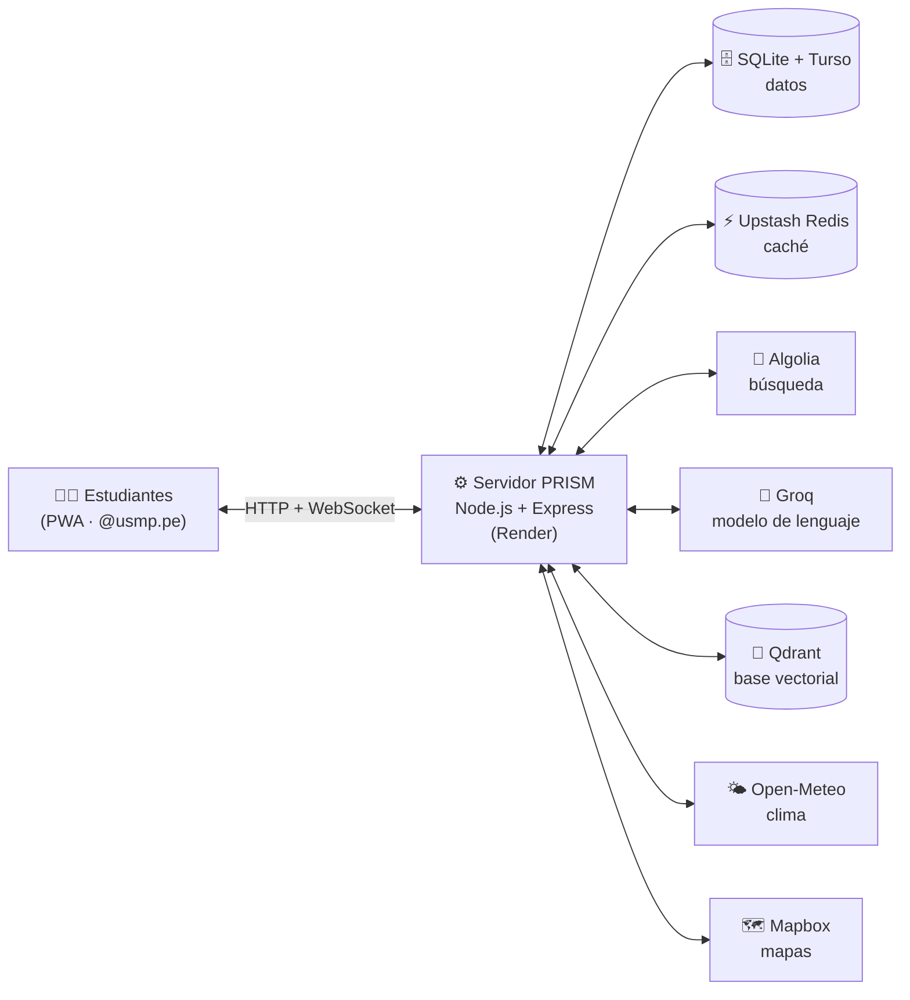

# 🔮 PRISM — Red Social Universitaria USMP

[](https://prisma-pruebas-99uj.onrender.com)
[](https://github.com/jeanalvarez4004/prisma-pruebas)
[](https://deepwiki.com/jeanalvarez4004/prisma-pruebas/1-overview)


**PRISM** es la red social universitaria de la **USMP Filial Sur (Arequipa)**. Reúne en una sola aplicación web instalable (PWA) el feed del campus, la inscripción a actividades en tiempo real, un chat entre estudiantes y un asistente con inteligencia artificial. El acceso es exclusivo para correos institucionales **@usmp.pe**.

---

## 📑 Contenido

- [Enlaces](#-enlaces)
- [Funcionalidades](#-funcionalidades)
- [Arquitectura](#-arquitectura)
- [Tolerancia a fallos](#-tolerancia-a-fallos)
- [Tecnologías usadas](#-tecnologías-usadas)
- [Asistente con IA](#-asistente-con-ia)
- [Machine learning](#-machine-learning)
- [API REST](#-api-rest)
- [Eventos en tiempo real](#-eventos-en-tiempo-real-socketio)
- [Modelo de datos](#-modelo-de-datos)
- [Seguridad](#-seguridad)
- [Estructura del proyecto](#-estructura-del-proyecto)
- [Ejecutar en local](#-ejecutar-en-local)
- [Variables de entorno](#-variables-de-entorno)
- [Despliegue](#-despliegue)

---

## 📌 Enlaces

| | |
| :-- | :-- |
| 🌐 **App en vivo** | https://prisma-pruebas-99uj.onrender.com |
| 💻 **Repositorio** | https://github.com/jeanalvarez4004/prisma-pruebas |
| 📚 **Documentación** | https://deepwiki.com/jeanalvarez4004/prisma-pruebas/1-overview |

---

## ✨ Funcionalidades

### 🔐 Acceso e identidad
- Registro e inicio de sesión **solo con correo `@usmp.pe`**.
- Contraseñas cifradas con **bcrypt** y sesiones con cookie `httpOnly`.
- Perfil de estudiante editable, con sus publicaciones.

### 📰 Feed del campus
- Publicaciones por categoría, con reacciones (*likes*) que se actualizan en vivo.
- **Historias de 24 horas**, que desaparecen solas.
- Feed acelerado con **caché en Redis** (`X-Cache: HIT / MISS`).

### 📅 Actividades e inscripciones
- Creación de actividades con ubicación en un **mapa interactivo (Mapbox)**.
- **Inscripción inmediata** con control de cupos en una sola operación atómica: nunca se asigna el mismo cupo dos veces.
- Cupos y avisos que se actualizan al instante para todos los conectados.

### 💬 Comunicación en tiempo real
- **Chat del campus** con historial.
- **Presencia en línea** y **notificaciones** en vivo.
- Moderación automática de mensajes y publicaciones.

### 🔎 Búsqueda
- Búsqueda instantánea de publicaciones y actividades con **Algolia**.
- Si Algolia no está disponible, la búsqueda se hace en SQLite.

### 🤖 Asistente con IA
- Responde dudas del campus con respuestas en *streaming*.
- Se basa en el reglamento y las guías del campus (**RAG**), en las actividades disponibles y en el **clima de Arequipa**.
- Tiene memoria por estudiante y **aprendizaje supervisado**: una respuesta solo pasa a su base de conocimiento cuando un administrador la aprueba.

### 📊 Panel de administración
- Carga de reglamentos y guías para el asistente.
- Bandeja de aprendizaje (aprobar con **«Enseñar»**).
- Reportes de sentimiento de los mensajes de contacto.
- Estado en vivo de cada servicio externo y sincronización del índice de Algolia.

### 📱 PWA
- Se instala en el celular o la PC como una app.
- **Service Worker** con caché de la interfaz para abrir sin conexión.
- Diseño *mobile-first* con la paleta institucional USMP.

---

## 🏗️ Arquitectura

PRISM es un **monolito modular**: un solo servidor Node.js + Express sirve la PWA, la API REST y los WebSockets, y delega tareas especializadas a servicios en la nube.



---

## 🛡️ Tolerancia a fallos

Cada servicio externo es **opcional**. Si falta su credencial o no responde, PRISM usa un respaldo local y sigue funcionando:

| Servicio | Si no está disponible… |
| :-- | :-- |
| **Turso** | Los datos se guardan solo en SQLite local. |
| **Upstash Redis** | El feed se lee directamente de SQLite. |
| **Algolia** | La búsqueda se hace con consultas `LIKE` en SQLite. |
| **Groq** | El asistente responde en modo de contingencia. |
| **Qdrant** | La búsqueda semántica usa los fragmentos guardados en SQLite. |
| **OpenAI Moderation** | La moderación usa solo la lista local. |

---

## 🛠️ Tecnologías usadas

| Área | Tecnología |
| :-- | :-- |
| Diseño | Figma |
| Frontend | HTML, CSS y JavaScript · PWA (Service Worker + Web Manifest) |
| Backend | Node.js 20 + Express |
| Base de datos | SQLite (better-sqlite3) + Turso (réplica en la nube con libSQL) |
| Caché | Upstash Redis (API REST) |
| Búsqueda | Algolia |
| Inteligencia artificial | Groq (modelo de lenguaje con *function calling*) |
| Base vectorial (RAG) | Qdrant |
| Tiempo real | Socket.IO |
| Machine learning | Naive Bayes y factorización de matrices (implementación propia en JavaScript) |
| Moderación | Lista local + OpenAI Moderation API |
| Mapas y clima | Mapbox · Open-Meteo |
| Seguridad | bcryptjs · cookies `httpOnly` · cookie-parser |
| Despliegue | Render (despliegue continuo desde GitHub) |
| Control de versiones | Git + GitHub (ramas `feature/*`, `fix/*` y `docs/*`) |

---

## 🤖 Asistente con IA

El asistente (`POST /api/asistente`) usa un modelo de lenguaje en **Groq** con respuestas en *streaming*. Según la pregunta, el modelo decide qué herramienta llamar antes de responder:

| Herramienta | Qué hace | Fuente |
| :-- | :-- | :-- |
| `buscar_conocimiento` | Busca en el reglamento y las guías del campus (RAG) | Qdrant / SQLite |
| `consultar_actividades` | Consulta actividades, fechas y cupos disponibles | SQLite |
| `clima_actual` | Obtiene el clima del campus de Arequipa | Open-Meteo |

**Aprendizaje supervisado:** cuando un estudiante califica una respuesta con 👍, el par pregunta-respuesta queda en una bandeja de espera. Solo se incorpora al conocimiento del asistente cuando un administrador lo aprueba desde el panel.

---

## 📈 Machine learning

Los modelos están implementados desde cero en `services/ml.js` y se entrenan con los datos de la carpeta `ml/`:

| Modelo | Algoritmo | Uso |
| :-- | :-- | :-- |
| **Análisis de sentimiento** | Naive Bayes | Clasifica los mensajes de contacto como positivo, neutro o negativo. |
| **Categoría de publicaciones** | Naive Bayes | Sugiere la categoría de una publicación según su texto. |
| **Recomendador de actividades** | Factorización de matrices | Recomienda actividades según las inscripciones de estudiantes con intereses parecidos. A un usuario nuevo le muestra las más populares. |

---

## 🔌 API REST

| Módulo | Endpoints principales |
| :-- | :-- |
| **Autenticación** | `POST /api/auth/register` · `POST /api/auth/login` · `POST /api/auth/logout` · `GET /api/me` |
| **Perfil** | `GET/PUT/PATCH /api/profile` · `GET /api/profile/posts` |
| **Feed** | `GET /api/feed` · `POST /api/posts` · `DELETE /api/posts/:id` · `POST /api/posts/:id/like` |
| **Historias** | `POST /api/stories` · `DELETE /api/stories/:id` |
| **Actividades** | `POST /api/activities` · `DELETE /api/activities/:id` · `POST /api/activities/:id/join` |
| **Inscripciones** | `POST /api/inscripciones` · `GET /api/inscripciones/mias` |
| **Búsqueda** | `GET /api/search` |
| **Asistente** | `POST /api/asistente` · `POST /api/asistente/feedback` · `GET/DELETE /api/asistente/memoria` |
| **Machine learning** | `GET /api/recomendaciones` · `GET /api/ml/predict` · `POST /api/contacto` |
| **Notificaciones** | `GET /api/notifications` · `POST /api/notifications/read` · `DELETE /api/notifications/:id` |
| **Clima y mapas** | `GET /api/weather` · `GET /api/config/mapbox` |
| **Caché** | `GET /api/redis/stats` · `POST /api/redis/clear` |
| **Administración** | `GET /api/admin/resumen` · `GET /api/admin/estado` · `GET /api/admin/reportes` · `GET /api/admin/usuarios` · `GET/POST /api/admin/conocimiento` · `GET /api/admin/aprendizaje` · `POST /api/admin/search/sync` |
| **Salud** | `GET /api/health` |

---

## ⚡ Eventos en tiempo real (Socket.IO)

| Evento | Dirección | Descripción |
| :-- | :-- | :-- |
| `user:identify` | Cliente → Servidor | Asocia la conexión con el usuario de la sesión. |
| `chat:send` | Cliente → Servidor | Envía un mensaje al chat del campus. |
| `chat:get_history` | Cliente → Servidor | Pide el historial del chat. |
| `chat:message` | Servidor → Todos | Nuevo mensaje en el chat. |
| `chat:history` | Servidor → Cliente | Historial del chat. |
| `chat:blocked` | Servidor → Cliente | El mensaje fue bloqueado por moderación. |
| `presence:update` | Servidor → Todos | Estudiantes conectados en este momento. |
| `feed:new_post` · `feed:post_liked` · `feed:post_deleted` | Servidor → Todos | Cambios del feed en vivo. |

---

## 🗄️ Modelo de datos

Tablas principales en SQLite / Turso:

| Dominio | Tablas |
| :-- | :-- |
| Usuarios y sesiones | `users`, `sessions` |
| Feed | `posts`, `post_likes`, `stories` |
| Actividades | `activities`, `activity_members`, `enrollments` |
| Comunicación | `chat_messages`, `notifications`, `contact_messages` |
| Asistente | `knowledge_docs`, `knowledge_chunks`, `assistant_logs` |

---

## 🔒 Seguridad

- Registro restringido a correos institucionales `@usmp.pe`.
- Contraseñas cifradas con bcrypt; nunca se guardan en texto plano.
- Cookie de sesión `httpOnly` con `sameSite: 'lax'`.
- Panel de administración protegido por rol (`ADMIN_EMAILS`).
- Moderación de contenido en dos capas: lista local y OpenAI Moderation API.
- Credenciales gestionadas con variables de entorno, nunca dentro del código.

---

## 📁 Estructura del proyecto

```
├── server.js            # Servidor Express: API REST, sesiones y Socket.IO
├── redis-client.js      # Cliente de Upstash Redis (caché)
├── services/
│   ├── assistant.js     # Asistente con IA (Groq + herramientas)
│   ├── knowledge.js     # Base de conocimiento y RAG (Qdrant)
│   ├── memory.js        # Memoria y aprendizaje supervisado
│   ├── documents.js     # Procesamiento de documentos
│   ├── search.js        # Búsqueda (Algolia + respaldo SQLite)
│   ├── ml.js            # Modelos de machine learning
│   ├── moderation.js    # Moderación de contenido
│   ├── weather.js       # Clima del campus (Open-Meteo)
│   └── http.js          # Utilidades HTTP
├── index.html           # Aplicación web (PWA)
├── app.js               # Lógica principal del cliente
├── features.js          # Chat, búsqueda, inscripciones y administración
├── ux.js                # Interacciones de interfaz
├── styles.css           # Estilos e identidad visual
├── sw.js                # Service Worker
├── manifest.webmanifest # Manifiesto de la PWA
├── ml/                  # Datos de entrenamiento de los modelos
├── docs-ejemplo/        # Documentos base para el asistente
├── scripts/             # Datos de ejemplo y pruebas
└── render.yaml          # Configuración de despliegue en Render
```

---

## 🚀 Ejecutar en local

**Requisitos:** Node.js 20 o superior.

```bash
npm ci
cp .env.example .env   # completar las variables necesarias
npm run seed           # (opcional) carga datos de ejemplo
npm start
```

La aplicación queda disponible en `http://localhost:3000`.

| Script | Descripción |
| :-- | :-- |
| `npm start` | Inicia el servidor. |
| `npm run dev` | Inicia el servidor y lo reinicia al detectar cambios. |
| `npm run seed` | Carga datos de ejemplo. |
| `npm run test:ml` | Prueba los modelos de machine learning. |
| `npm run test:sockets` | Prueba los eventos de Socket.IO. |
| `npm run check` | Revisa la sintaxis de los archivos principales. |

---

## ⚙️ Variables de entorno

Solo se necesitan `PORT` y `SESSION_SECRET` para iniciar. El resto activa servicios opcionales.

| Variable | Servicio |
| :-- | :-- |
| `PORT`, `SESSION_SECRET`, `NODE_ENV` | Servidor |
| `DATABASE_PATH` | Ruta del archivo SQLite |
| `TURSO_DATABASE_URL`, `TURSO_AUTH_TOKEN` | Turso |
| `UPSTASH_REDIS_REST_URL`, `UPSTASH_REDIS_REST_TOKEN` | Upstash Redis |
| `ALGOLIA_APP_ID`, `ALGOLIA_ADMIN_KEY`, `ALGOLIA_INDEX` | Algolia |
| `GROQ_API_KEY`, `GROQ_MODEL` | Groq |
| `QDRANT_URL`, `QDRANT_API_KEY`, `QDRANT_COLLECTION` | Qdrant |
| `EMBEDDINGS_API_KEY`, `EMBEDDINGS_API_URL`, `EMBEDDINGS_MODEL` | Embeddings remotos |
| `OPENAI_API_KEY` | OpenAI Moderation |
| `MAPBOX_TOKEN` | Mapbox |
| `ADMIN_EMAILS` | Correos con rol de administrador |

---

## ☁️ Despliegue

La aplicación se despliega en **Render** con `render.yaml`:

- Cada cambio en `main` se despliega automáticamente.
- Build: `npm ci --omit=dev` · Inicio: `npm start`.
- Chequeo de salud en `/api/health`.
- Las credenciales se configuran como variables de entorno en Render.
